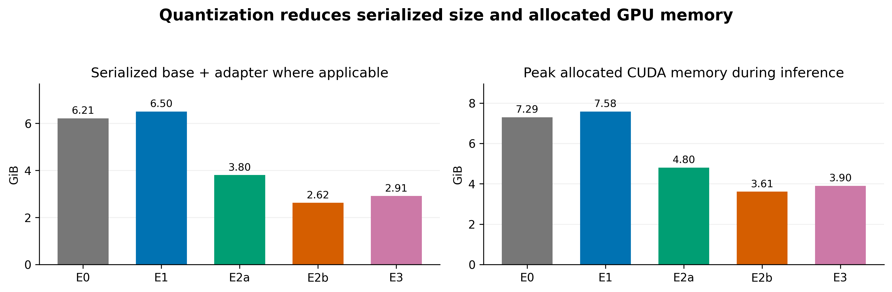
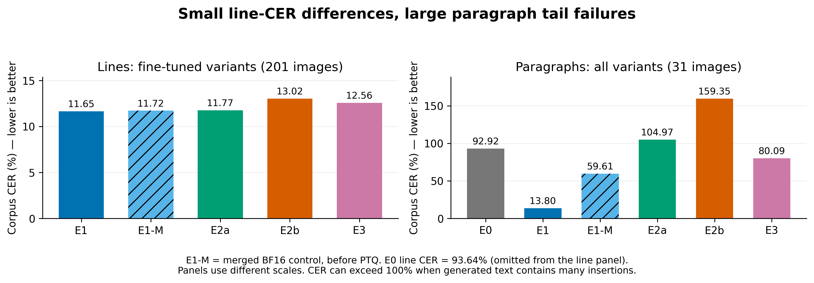

# DeepSeek-OCR Quantization

Fine-tuning and low-bit benchmarking for Vietnamese handwriting recognition using PyTorch and PEFT. The experiments compare accuracy, storage, GPU memory, and inference latency on NVIDIA A30 GPUs.

## Experiments and results

All experiments evaluate the same **201 lines and 31 paragraphs**. Training uses 8,141 labeled images; 44 unlabeled images are excluded. E1/E3 use one epoch, seed 42, LoRA rank 16, and an effective batch size of 16.

| ID | Configuration | Line CER | Paragraph CER | Storage (GiB) | Peak GPU (GiB) |
| --- | --- | ---: | ---: | ---: | ---: |
| E0 | Pretrained BF16 | 93.64% | 92.92% | 6.21 | 7.29 |
| E1 | BF16 + LoRA | **11.65%** | **13.80%** | 6.50 | 7.58 |
| E2a | E1 merged, INT8 PTQ | 11.77% | 104.97% | 3.80 | 4.80 |
| E2b | E1 merged, NF4 PTQ | 13.02% | 159.35% | **2.62** | **3.61** |
| E3 | Original NF4 base + QLoRA | 12.56% | 80.09% | 2.91 | 3.90 |

NF4 PTQ reduces storage by **59.7%** and peak allocated GPU memory by **52.4%** compared with E1, with a **1.37 percentage-point** increase in line CER. Vision modules and the output head remain unquantized.





Repetitive outputs drive most paragraph errors: five NF4 predictions that hit the token limit account for **95.4%** of paragraph edits. BF16 merging alone raises paragraph CER to **59.61%**, so the PTQ penalty cannot be attributed entirely to quantization. Nine preprocessing checks passed, but the cause of repetition remains unverified.

The [benchmark CSV](results/analysis/summary.csv) includes recorded latency.

## Setup and execution

Training requires Linux, CUDA, and a BF16-capable GPU with enough memory for the selected experiment. From the repository root:

```bash
conda env create -f environment.yml
conda activate deepseek
python -m src.data --config configs/E0.yaml
python -m src.evaluate --config configs/E0.yaml --output results/rerun/E0

for id in E1 E3; do
  python -m src.train --config configs/$id.yaml &&
  python -m src.evaluate --config configs/$id.yaml --output results/rerun/$id || break
done

for id in E2a E2b; do
  python -m src.quantize --config configs/$id.yaml &&
  python -m src.evaluate --config configs/$id.yaml --output results/rerun/$id || break
done
```

E2a/E2b require a completed E1 run and must run sequentially. Use fresh output directories; resume training with `--resume models/<ID>/checkpoint-<step>`. Set dataset and artifact paths in YAML, and the cache location with `HF_HOME`.

One GPU uses 16 accumulation steps to preserve effective batch size 16. Optional two-GPU training uses `torchrun --standalone --nproc_per_node=2 -m src.train --config configs/<ID>.yaml` and automatically uses eight accumulation steps. Resume with the same GPU count as the checkpoint.

## Evaluation and repository map

CER is `(substitutions + deletions + insertions) / reference characters`; pooled CER is character-weighted and may exceed 100%. Latency includes image loading through decoding; memory reports peak CUDA allocation.

- `src/`, `configs/`, `tests/`: pipeline, pinned experiment settings, and unit tests.
- [results/standard/](results/standard/): validated metrics and predictions; [results/quantization/](results/quantization/): merge/PTQ provenance.
- [Paragraph errors](results/analysis/paragraph_errors.csv), [failure chart](figures/paragraph_failures.png), [memory chart](figures/storage_memory.png), and [example](figures/paragraph_example.png).

```bash
python -m pytest -q
python figures/gen_fig_results.py
```

Datasets are in `UIT_HWDB_line/` and `UIT_HWDB_paragraph/`.
